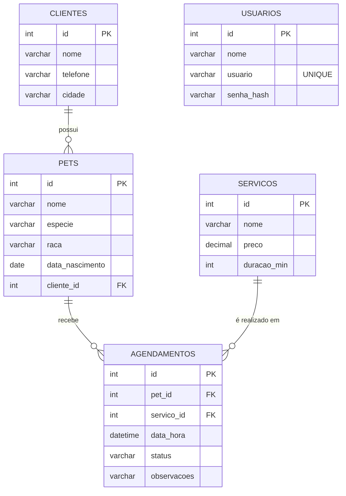

# Modelo lógico / DER — PetHub

Diagrama em Mermaid (cole em https://mermaid.live para gerar a imagem) — ou gere o diagrama oficial no
MySQL Workbench: menu **Database > Reverse Engineer...** → escolha o banco `petshop` → finalize.
O Workbench monta o EER automaticamente com as chaves estrangeiras.

**Relacionamentos (1:N):** um cliente tem vários pets; um pet tem vários agendamentos; um serviço aparece em vários agendamentos.
`usuarios` é independente (somente login do sistema).
